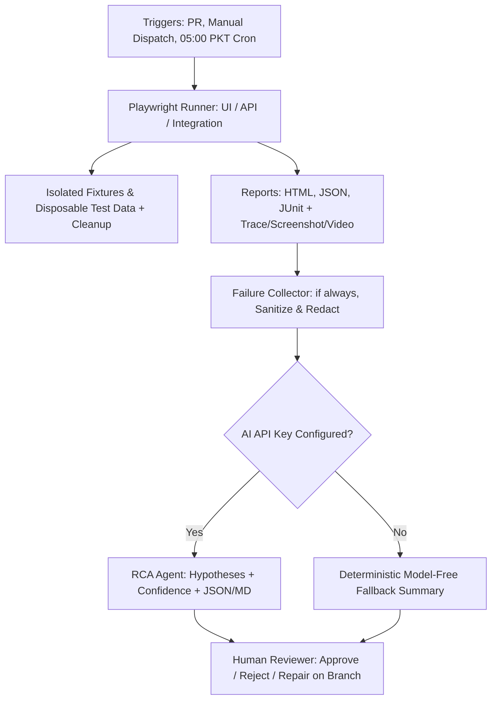

# Architecture

## System Flow & Interfaces

- **Triggers & Scheduling:** Executed locally via npm scripts or automatically in GitHub Actions on pull requests, manual `workflow_dispatch`, and scheduled daily runs at `00:00 UTC` (`05:00 Asia/Karachi`).
- **Test Execution Layer:** Organized into Page Objects (`src/pages/`), typed API clients and validators (`src/api/`), per-worker isolated fixtures with deterministic teardown cleanup (`src/fixtures/`), utilities (`src/utils/`), and tagged test suites (`tests/ui/`, `tests/api/`, `tests/integration/`).
- **Evidence & Failure Collection:** Playwright captures HTML, JSON, and JUnit reports along with traces, screenshots, and videos on failure. The `tools/rca/` collector runs with `if: always()` to bundle failure metadata and redact secrets, personal data, and payment fields.
- **Agent & Skill Contracts:** Orchestrated via `agents/orchestrator.md` and specialized markdown contracts in `skills/test-design.md`, `skills/playwright.md`, `skills/rca.md`, and `skills/review.md`.
- **Human Approval Gates & Stop Conditions:** Human reviewers approve test coverage and priorities, inspect PRs, verify RCA classifications, approve branch-only repair patches, and own release go/no-go decisions. Execution halts or degrades safely to a deterministic summary when AI credentials are absent, artifacts are missing, or security/redaction rules are violated.